# NabuRAG

<div align="center">


**A high-performance, deterministic, enterprise-grade Retrieval-Augmented Generation (RAG) system built from scratch with Bun, Docker (Qdrant & PostgreSQL 16), and React 19.**

*Zero AI-framework bloat (no LangChain, no LlamaIndex) — engineered for precision, auditability, zero hallucinations, and complete data privacy.*

</div>

---

## Executive Summary

Most generative AI demos rely on heavy wrapper frameworks, lack test coverage, and suffer from unpredictable latency and hallucinations. 

**NabuRAG** was engineered from first principles to demonstrate **senior-level AI systems and software engineering**:
- **Zero Framework Bloat**: Pure TypeScript with native `fetch` and direct client drivers. Zero reliance on LangChain, LlamaIndex, or third-party orchestrators.
- **Strict Grounding & Verifiable Citations**: LLM responses are constrained via **Zod JSON Schema** (`z.toJSONSchema()`). Answers must cite exact source files, sections/pages, and verbatim excerpts, or explicitly **abstain** when evidence is missing.
- **Deterministic & Idempotent Ingestion**: Chunks receive deterministic RFC 4122 **UUIDv5** identifiers based on content namespace. SHA-256 hashing prevents duplicate embeddings and guarantees atomic updates across both vector and relational stores.
- **Enterprise Multilingual Retrieval**: Powered by **`bge-m3`** (1024 dimensions, Cosine distance) running on local Ollama, excelling at technical and regulatory German/English corpora.
- **Polyglot Persistence**: Clear separation of concerns — **Qdrant** for high-dimensional vector search with payload filtering; **PostgreSQL 16** with foreign-key cascades for document metadata, chunk tracking, and benchmark evaluation runs.
- **Full-Stack Production Rigor**: 32 automated unit and integration tests passing in ~4 seconds, automated GitHub Actions CI, and a responsive React 19 + Tailwind CSS + shadcn/ui dashboard.

---

## Architectural Highlights & Engineering Decisions

### 1. Why Zero AI Frameworks?
Enterprise production systems demand microsecond predictability, high reliability, transparent debugging, and tight security controls. Heavy AI frameworks (LangChain, LlamaIndex) introduce:
- Deep, opaque call stacks and fragile monkey-patched abstractions.
- Volatile dependency churn and breaking API updates.
- Inflexible prompt wrappers that complicate auditability and compliance.

NabuRAG uses a lightweight, transparent client layer with native `fetch`, connecting directly to Ollama or OpenRouter/OpenAI-compatible APIs. Schema enforcement is handled via compile-time and runtime **Zod** models, achieving zero-overhead type safety and predictable execution.

### 2. Deterministic Ingestion & Idempotency
- **UUIDv5 Chunk Identification**: Chunk IDs are computed as `UUIDv5(NAMESPACE, `${source_file}:s${section_num}:c${chunk_idx}`)`. Running ingestion multiple times produces identical IDs, preventing duplicate vector growth.
- **SHA-256 Change Detection**: Every document is hashed upon ingestion. Unmodified files are skipped automatically. Modified files trigger an atomic cascading delete in PostgreSQL and Qdrant before re-indexing.
- **Boundary-Aware Multi-Format Parsing**:
  - **`.pdf`**: Page-level extraction preserving source page numbers (`unpdf`).
  - **`.docx`**: Heading and section normalization (`mammoth`).
  - **`.html` / `.htm`**: DOM tag cleaning and hierarchical section splitting (`cheerio`).
  - **`.md`**: Markdown heading hierarchy preservation (`h1`–`h3`).
  - **`.txt`**: Paragraph-safe logical boundary chunking.
  - **`.json`**: Structured entity and record extraction for SecOps advisories and logs.

### 3. Anti-Hallucination & Explicit Abstention
In mission-critical enterprise domains (legal, medical, security), a wrong answer is vastly worse than no answer. NabuRAG enforces a strict binary abstention rule:
- If the retrieved context does not contain sufficient factual evidence to answer the question, the model **must** output `{"answer": "...", "abstained": true, "citations": []}`.
- Every claim made in an answer must be backed by an inline citation referencing `source_file`, `heading`, `section_number`, and a verbatim `quote`.

### 4. Hybrid Dual-Database Architecture
- **Qdrant**: Ingests 1024-dimensional dense vectors with HNSW indexing and metadata payload filters (`source_file`).
- **PostgreSQL 16**: Enforces relational data integrity with `ON DELETE CASCADE` foreign keys:
  - `documents`: Source file path, hash, section count, chunk count, timestamps.
  - `chunks`: Relational link to document, section number, heading, character offsets.
  - `eval_results`: Persistent benchmark history (hit rates, accuracy scores, latency metrics).

---

## Core Competencies & Skills Demonstrated

| Area | Engineering Capabilities & Implementation |
| :--- | :--- |
| **Backend & Systems Architecture** | Microsecond HTTP API with native `Bun.serve`, streaming file uploads, path traversal mitigation, and multi-container Docker Compose orchestration (`app`, `postgres`, `qdrant`, `ollama`). |
| **Applied AI & Information Retrieval** | Multilingual semantic embedding (`bge-m3`), top-k vector retrieval with payload filters, prompt engineering for zero hallucination, and structured JSON Schema generation via Zod. |
| **Database & Data Engineering** | Polyglot storage design (relational + vector), ACID relational schemas with foreign key cascades, SHA-256 content deduplication, and multi-format document parsing (PDF, Word, HTML, Markdown, JSON). |
| **Frontend & UI Engineering** | Modern SPA with React 19, TypeScript, Tailwind CSS, Vite proxying, and shadcn/ui accessible components for interactive querying, document upload, and evaluation inspection. |
| **Software Quality & DevOps** | 32 comprehensive automated tests (unit, database, API, and retrieval), automated GitHub Actions CI pipeline, and strict TypeScript compilation (`tsc --noEmit`). |

---

## Enterprise & Business Use Cases

NabuRAG is specifically built for privacy-critical, highly regulated, and audit-sensitive corporate environments where proprietary data cannot leave local infrastructure.

### 1. Legal, Risk & Regulatory Compliance (EU AI Act, GDPR, ISO/BSI)
- **Problem**: Compliance teams spend hundreds of hours cross-referencing complex statutory texts (EU AI Act, DSGVO/GDPR, BGB) and internal audit standards. Cloud LLM tools risk leaking confidential filings.
- **How NabuRAG solves it**: Fully on-premises execution with zero external data transmission. Every query returns verifiable citations down to the exact section, article, or page with verbatim source quotes.
- **Example query**: *"Welche Dokumentationspflichten gelten für Hochrisiko-KI-Systeme nach dem EU AI Act?"*

### 2. Cybersecurity, SecOps & IT-Grundschutz Audits
- **Problem**: Security analysts must correlate national security frameworks (BSI IT-Grundschutz, ISO 27001, NIS2) with raw JSON vulnerability feeds (CVEs, incident tickets) and internal hardening runbooks.
- **How NabuRAG solves it**: Unified parsing of structured `.json` feeds alongside `.html` standards and `.pdf` guidelines allows analysts to cross-examine operational logs and regulatory controls simultaneously.
- **Example query**: *"How do our incident response SLAs align with BSI IT-Grundschutz reporting requirements?"*

### 3. Procurement, Vendor Contracts & EVB-IT SOW Analysis
- **Problem**: Evaluating tender proposals, public sector contracts (e.g., German EVB-IT agreements), and vendor Master Service Agreements (MSAs) across multiple `.docx` and `.pdf` files is error-prone.
- **How NabuRAG solves it**: Source-filtered vector search isolates specific vendor agreements, accurately extracting terms on liability limits, termination periods, and warranty obligations.
- **Example query**: *"Welche Haftungsobergrenzen und Gewährleistungsfristen sind im aktuellen EVB-IT Dienstleistungsvertrag vereinbart?"*

### 4. Engineering Knowledge Base & Architecture Runbooks
- **Problem**: Architecture Decision Records (ADRs), post-mortems, and deployment runbooks are scattered across Markdown repos, PDFs, and internal wikis. Engineers need instant answers without exposing proprietary architectures.
- **How NabuRAG solves it**: Deterministic paragraph chunking preserves code syntax, configuration blocks, and API specs without truncation.
- **Example query**: *"What is our standard disaster recovery protocol for multi-region database failover?"*

### 5. HR Policies, Works Council (Betriebsrat) Agreements & Internal Bylaws
- **Problem**: Employees and HR staff regularly query travel expense policies, work-from-home agreements (*Betriebsvereinbarungen*), and benefit guidelines. Misinformation causes compliance violations and internal disputes.
- **How NabuRAG solves it**: Strict abstention guarantees the system explicitly responds *"I do not have sufficient information in the provided documents"* rather than fabricating allowances or policies that do not exist.
- **Example query**: *"Wie hoch ist die tägliche Verpflegungspauschale bei Auslandsreisen nach Frankreich?"*

---

## Architecture

```mermaid
flowchart TD
    subgraph Ingestion ["Ingestion Pipeline (CLI & Web Upload)"]
        Files["Documents in data/docs/<br/>(.pdf, .docx, .html, .md, .txt, .json)"] --> Loader["Multi-Format Doc Loader<br/>(unpdf, mammoth, cheerio)"]
        Loader --> RawSections["RawSection[] (Page/Heading metadata)"]
        RawSections --> Chunker["Deterministic Chunker<br/>(~800 chars, ~120 overlap, UUIDv5)"]
        Chunker --> Embed["Ollama bge-m3<br/>(1024-dim Cosine Embeddings)"]
        Embed --> Qdrant[("Qdrant Vector DB<br/>(:6333)")]
        Chunker --> Postgres[("PostgreSQL 16<br/>(:5432)")]
    end

    subgraph Query ["Query & Evaluation Pipeline"]
        UserQuery["User Question (CLI / Web UI)"] --> QueryEmbed["Embed Query via bge-m3"]
        QueryEmbed --> TopK["Qdrant Top-5 Search<br/>(Optional source_file filter)"]
        TopK --> PromptContext["Numbered Context Assembly<br/>[1] source (heading, page)"]
        PromptContext --> LLM["LLM (Ollama / OpenRouter)<br/>+ Zod JSON Schema Enforcement"]
        LLM --> Response["Grounded Answer + Citations<br/>or Explicit Abstention"]
    end
```



---

## Tech Stack & Infrastructure

| Layer | Technology | Purpose |
| :--- | :--- | :--- |
| **Engine / Runtime** | [Bun](https://bun.sh/) (v1.2+) | Fast JS/TS runtime, test runner, package manager, and microsecond HTTP server (`Bun.serve`) |
| **Vector Database** | [Qdrant](https://qdrant.tech/) (Docker) | Vector database for 1024-dimensional dense vectors with HNSW indexing (`:6333`) |
| **Relational Database** | [PostgreSQL 16](https://www.postgresql.org/) (Docker) | Relational storage for documents, chunk metadata, and golden evaluation runs (`:5432`) |
| **Embedding Model** | `bge-m3` via [Ollama](https://ollama.com/) | 1024-dim state-of-the-art multilingual embeddings (German/English) |
| **LLM Inference** | Ollama / OpenRouter | Local (`qwen2.5:7b-instruct`) or remote inference with strict JSON schema enforcement |
| **Frontend SPA** | React 19 + Vite + Tailwind + shadcn/ui | Clean, responsive web dashboard for querying, upload management, and benchmark visualization |
| **CI / Automation** | GitHub Actions | Automated build, multi-service testing, and type checks on every push and PR |

---

## Repository Structure

```text
naburag/
├── .github/
│   ├── workflows/ci.yml       # GitHub Actions CI workflow (PostgreSQL + Qdrant + Bun test)
│   └── pull_request_template.md
├── data/
│   └── docs/                  # Ingested documents (.pdf, .docx, .html, .md, .txt, .json)
├── eval/
│   ├── golden.json            # 10 QA benchmark pairs (8 answerable + 2 unanswerable)
│   └── run-eval.ts            # Golden set evaluation test runner
├── src/
│   ├── config.ts              # Zod-validated environment configuration
│   ├── llm.ts                 # Thin client for Ollama embeddings & structured completions
│   ├── types.ts               # Shared TypeScript schemas and interfaces
│   ├── server.ts              # Bun.serve() REST API routes and static asset serving
│   ├── db/
│   │   ├── postgres.ts        # PostgreSQL client (postgres.js) & schema initialization
│   │   └── qdrant.ts          # @qdrant/js-client-rest client & collection configuration
│   ├── ingest/
│   │   ├── doc-loader.ts      # Multi-format document parser & normalizer
│   │   ├── chunker.ts         # Paragraph/word-boundary chunker with deterministic UUIDv5
│   │   └── ingest.ts          # Idempotent ingestion CLI (bun run ingest)
│   └── retrieval/
│       ├── retrieve.ts        # Vector similarity search and structured generation
│       └── ask.ts             # Interactive query CLI (bun run ask)
├── test/                      # 32 automated unit and integration tests
│   ├── chunker.test.ts
│   ├── db.test.ts
│   ├── doc-loader.test.ts
│   ├── eval.test.ts
│   ├── ingest.test.ts
│   ├── llm.test.ts
│   ├── retrieve.test.ts
│   └── server.test.ts
├── web/                       # React 19 + Vite + Tailwind CSS + shadcn/ui frontend
│   ├── src/
│   │   ├── App.tsx            # Main layout with tab navigation
│   │   ├── components/        # AskTab, DocsTab, EvalTab, and UI primitives
│   │   └── api.ts             # Typed REST API client
│   └── vite.config.ts         # Dev server with /api proxy to Bun
├── docker-compose.yml         # Container definitions for Qdrant, PostgreSQL, and Ollama
├── CONTRIBUTING.md            # Open-source contribution guidelines & branching rules
├── SECURITY.md                # Vulnerability disclosure protocol
├── LICENSE                    # MIT License
├── package.json
└── tsconfig.json
```

---

## Quickstart & Local Setup

### 1. Prerequisites
- **[Bun](https://bun.sh/)** (v1.2 or higher)
- **[Docker Desktop](https://www.docker.com/)** or Docker Engine with Docker Compose
- **[Ollama](https://ollama.com/)** running locally on port `11434` (or configure OpenRouter/OpenAI in `.env`)

Pull the multilingual embedding and generation models:
```bash
# High-performance multilingual embedding model (1024 dimensions)
ollama pull bge-m3

# Instruction-tuned generation model
ollama pull qwen2.5:7b-instruct
```

### 2. Clone & Install
```bash
git clone https://github.com/feivlinus/naburag.git
cd naburag

# Install root dependencies
bun install

# Install web dashboard dependencies
bun install --cwd web
```

### 3. Environment Configuration
```bash
cp .env.example .env
```
*(Default settings connect seamlessly to local Docker containers and local Ollama).*

### 4. Start Infrastructure Containers
```bash
bun run infra:up
```
Starts PostgreSQL 16 (`:5432`) and Qdrant (`:6333`) with health checks and persistent Docker volumes.

### 5. Ingest Documents
Place your files in `data/docs/` and run the ingestion engine:
```bash
# Ingest new and modified documents (SHA-256 cached)
bun run ingest

# Force complete re-indexing
bun run ingest --force
```

### 6. Query via CLI
```bash
bun run ask "What is the notice period according to EVB-IT?"
```

### 7. Run the Golden Benchmark Suite
Evaluate retrieval accuracy, citation fidelity, and abstention performance against 10 ground-truth QA pairs:
```bash
bun run eval
```

### 8. Run the Web Dashboard & API
```bash
# Runs Bun backend (:3000) and Vite React frontend (:5173) concurrently
bun run dev
```
Open **[http://localhost:5173](http://localhost:5173)** in your browser.

---

## Verification & Testing

The repository includes a comprehensive test suite covering parsers, chunking logic, database idempotency, vector indexing, retrieval grounding, and API endpoints:

```bash
# Run the 32-test suite inside the containerized environment
docker compose exec app bun test

# Run TypeScript type check
docker compose exec app bun x tsc --noEmit

# Run web frontend build
docker compose exec app bun run --cwd web build
```

---

## Repository Protection & Governance

This repository is configured with professional open-source governance:
- **Protected `master` Branch**: Direct pushes to `master` are restricted. All modifications require Pull Requests and passing CI status checks.
- **Automated CI Checks**: Every PR triggers `.github/workflows/ci.yml`, running full TypeScript compilation and all 32 tests against live PostgreSQL and Qdrant instances.
- **Code Standards**: See [CONTRIBUTING.md](file:///CONTRIBUTING.md) and [SECURITY.md](file:///SECURITY.md).

---

## Author & Contact

**Felix** — *Senior AI & Full-Stack Systems Engineer*

- **GitHub**: [@feivlinus](https://github.com/feivlinus)
- **Repository**: [https://github.com/feivlinus/naburag](https://github.com/feivlinus/naburag)

*Open to senior roles in AI Systems Engineering, Backend Architecture, and Technical Leadership.*

---

## License

This project is licensed under the [MIT License](file:///LICENSE).
