# naburag

A lightweight, deterministic, multi-document **Retrieval-Augmented Generation (RAG)** pipeline built on **Bun**, **Docker** (Qdrant & PostgreSQL), and **React + shadcn/ui**, with **zero AI-framework bloat** (no LangChain, no LlamaIndex, no Vercel AI SDK).

Optimized for accurate multilingual and German/English document retrieval, strict grounding with inline citations, explicit abstention for out-of-scope questions, and verifiable evaluations against a Golden Set benchmark.

---

## Key Features

- **Lean & Native Runtime**: Built natively for **Bun** (`Bun.serve` REST API, native TypeScript execution, `Bun.CryptoHasher` for SHA-256 change detection, and `postgres.js`).
- **Zero Framework Bloat**: Pure `fetch` integration with local **Ollama** or OpenAI/OpenRouter compatible endpoints, leveraging **Zod** (`z.toJSONSchema()`) for schema-guaranteed structured JSON responses.
- **Multilingual Semantic Embeddings**: Powered by **`bge-m3`** (1024 dimensions, Cosine distance) via Ollama, excelling at mixed German and English technical and legal documents.
- **Robust Multi-Format Parsing**:
  - **`.pdf`**: Page-level extraction via `unpdf` preserving page numbers.
  - **`.docx`**: Structured text extraction via `mammoth`.
  - **`.html` / `.htm`**: DOM cleaning and header-based hierarchy splitting via `cheerio`.
  - **`.md`**: Heading-aware section splitting (`h1`–`h3`).
  - **`.txt`**: Paragraph-safe logical section chunking.
  - **`.json`**: Structured entity and record extraction for feeds, advisories, and ticket logs.
- **Deterministic & Idempotent Ingestion**:
  - Chunks normalized to **~800 characters** with **~120-character overlap** on word boundaries.
  - Deterministic RFC 4122 **UUIDv5** chunk IDs (`${source_file}:s${section_number}:c${chunk_index}`).
  - SHA-256 hashing skips unchanged files; re-ingestion cleanly and atomically replaces prior chunks in both PostgreSQL and Qdrant.
- **Grounded Answers & Citations**:
  - LLM outputs strict JSON answers with exact source citations (`source_file`, `heading`, `section_number`, and extracted quote).
  - Explicitly **abstains** when the retrieved context does not contain sufficient information to answer the question.
- **Automated Golden Set Evaluation**:
  - 10-question evaluation suite (8 answerable across diverse documents + 2 unanswerable controls) runnable via CLI and UI.
- **Modern Web Dashboard**:
  - React 19 + Vite + Tailwind CSS + shadcn/ui.
  - **Ask & Inspect**: Query documents with document filters, similarity scores, and retrieved chunk cards.
  - **Documents**: Drag-and-drop upload, synchronization, and chunk inspection drawer.
  - **Evaluation**: Run benchmarks and review pass/fail scorecards.

---

## Enterprise & Business Use Cases

NabuRAG is designed for privacy-critical, highly regulated, and audit-sensitive corporate environments where proprietary data cannot leave local infrastructure and hallucinations cannot be tolerated.

### 1. Legal, Risk & Regulatory Compliance (EU AI Act, GDPR, ISO/BSI)
- **Problem**: Compliance and legal teams spend hours cross-referencing complex statutory texts (e.g., EU AI Act, GDPR/DSGVO, German BGB) and internal audit requirements. Cloud LLM tools risk leaking client memos or sensitive corporate filings.
- **How NabuRAG solves it**: Operates completely on-premises with zero third-party data transmission. Queries return verifiable citations down to the exact section, article, or page with verbatim source quotes.
- **Example query**: *"Welche Dokumentationspflichten gelten für Hochrisiko-KI-Systeme nach dem EU AI Act?"*

### 2. Cybersecurity, SecOps & IT-Grundschutz Audits
- **Problem**: Security analysts need to correlate national security standards (BSI IT-Grundschutz, ISO 27001, NIS2) with raw JSON vulnerability feeds (CVEs, SecOps ticket logs) and internal hardening runbooks.
- **How NabuRAG solves it**: Native parsing of structured `.json` feeds alongside `.html` standards and `.pdf` guidelines allows analysts to query both operational ticket history and regulatory controls in one unified search.
- **Example query**: *"How do our incident response SLAs align with the BSI IT-Grundschutz reporting requirements?"*

### 3. Procurement, Vendor Contracts & EVB-IT SOW Analysis
- **Problem**: Evaluating complex tender documents, public sector standard contracts (e.g., German EVB-IT agreements), and vendor Master Service Agreements (MSAs) across multiple `.docx` and `.pdf` files is labor-intensive and prone to missed liability clauses.
- **How NabuRAG solves it**: Document-filtered search allows procurement teams to restrict answers to specific vendor contracts, extracting precise terms on liability limits, termination periods, and warranty obligations.
- **Example query**: *"Welche Haftungsobergrenzen und Gewährleistungsfristen sind im aktuellen EVB-IT Dienstleistungsvertrag vereinbart?"*

### 4. Engineering Knowledge Base & Internal Architecture Runbooks
- **Problem**: Technical documentation, architecture decision records (ADRs), and post-mortem postmortems are fragmented across Markdown repos, PDFs, and internal wikis. Engineers need fast answers without exposing proprietary system designs.
- **How NabuRAG solves it**: Deterministic paragraph-level chunking preserves code blocks, API specifications, and architectural diagrams without stripping syntax.
- **Example query**: *"What is our standard disaster recovery protocol for multi-region database failover?"*

### 5. HR Policies, Works Council (Betriebsrat) Agreements & Internal Guidelines
- **Problem**: Employees and HR personnel frequently query company bylaws, travel expense policies, work-from-home agreements (Betriebsvereinbarungen), and benefit packages. Misinformation causes compliance violations and internal friction.
- **How NabuRAG solves it**: **Strict Abstention Guarantee** ensures the system explicitly says *"I don't know based on the provided documents"* rather than hallucinating benefits, allowances, or employment rules that do not exist.
- **Example query**: *"Wie hoch ist die tägliche Verpflegungspauschale bei Auslandsreisen nach Frankreich?"*

---

## Architecture

```mermaid
flowchart TD
    subgraph Ingestion ["Ingestion Pipeline (CLI & Web Upload)"]
        Files["Documents in data/docs/<br/>(.pdf, .docx, .html, .md, .txt, .json)"] --> Loader["Multi-Format Doc Loader<br/>(unpdf, mammoth, cheerio)"]
        Loader --> RawSections["RawSection[] (Page/Heading metadata)"]
        RawSections --> Chunker["Deterministic Chunker<br/>(~800 chars, ~120 overlap, UUIDv5)"]
        Chunker --> Embed["Ollama bge-m3<br/>(1024-dim Cosine Embeddings)"]
        Embed --> Qdrant[("Qdrant Vector DB<br/>(:6333)")]
        Chunker --> Postgres[("PostgreSQL 16<br/>(:5432)")]
    end

    subgraph Query ["Query & Evaluation Pipeline"]
        UserQuery["User Question (CLI / Web UI)"] --> QueryEmbed["Embed Query via bge-m3"]
        QueryEmbed --> TopK["Qdrant Top-5 Search<br/>(Optional source_file filter)"]
        TopK --> PromptContext["Numbered Context Assembly<br/>[1] source (heading, page)"]
        PromptContext --> LLM["LLM (Ollama / OpenRouter)<br/>+ Zod JSON Schema Enforcement"]
        LLM --> Response["Grounded Answer + Citations<br/>or Explicit Abstention"]
    end
```



---

## Tech Stack & Local Infrastructure

| Component | Technology | Description |
| :--- | :--- | :--- |
| **Runtime** | [Bun](https://bun.sh/) | Fast JavaScript/TypeScript engine, test runner, package manager |
| **Vector Store** | [Qdrant](https://qdrant.tech/) (Docker) | Vector database for 1024-dimension `bge-m3` embeddings (`:6333`) |
| **Metadata DB** | [PostgreSQL 16](https://www.postgresql.org/) (Docker) | Relational storage for documents, chunks, and eval runs (`:5432`) |
| **Embedding Model** | `bge-m3` via [Ollama](https://ollama.com/) | 1024-dim multilingual embeddings with cosine similarity |
| **LLM Inference** | Ollama / OpenRouter | Local or remote LLM with structured JSON schema outputs |
| **Frontend** | React 19 + Vite + Tailwind + shadcn/ui | Clean, responsive SPA dashboard for querying and document management |

---

## Repository Structure

```text
naburag/
├── data/
│   └── docs/                  # Ingested documents (.pdf, .docx, .html, .md, .txt, .json)
├── eval/
│   ├── golden.json            # 10 QA benchmark pairs (8 answerable + 2 unanswerable)
│   └── run-eval.ts            # Golden set evaluation test runner
├── src/
│   ├── config.ts              # Zod-validated environment configuration
│   ├── llm.ts                 # Thin client for Ollama embeddings & structured completions
│   ├── types.ts               # Shared TypeScript schemas and interfaces
│   ├── server.ts              # Bun.serve() REST API routes
│   ├── db/
│   │   ├── postgres.ts        # PostgreSQL client (postgres.js) & schema initialization
│   │   └── qdrant.ts          # @qdrant/js-client-rest client & collection configuration
│   ├── ingest/
│   │   ├── doc-loader.ts      # Multi-format document parser & normalizer
│   │   ├── chunker.ts         # Paragraph/word-boundary chunker with deterministic UUIDv5
│   │   └── ingest.ts          # Idempotent ingestion CLI (bun run ingest)
│   └── retrieval/
│       ├── retrieve.ts        # Vector similarity search and structured generation
│       └── ask.ts             # Interactive query CLI (bun run ask)
├── web/                       # React 19 + Vite + Tailwind CSS + shadcn/ui frontend
│   ├── src/
│   │   ├── App.tsx            # Main layout with tab navigation
│   │   ├── components/        # AskTab, DocsTab, EvalTab, and UI primitives
│   │   └── api.ts             # Typed REST API client
│   └── vite.config.ts         # Dev server with /api proxy to Bun
├── docs/                      # Architectural specifications and decision logs
├── openspec/                  # OpenSpec change proposals and task tracking
├── docker-compose.yml         # Container definitions for Qdrant and PostgreSQL
├── package.json
└── tsconfig.json
```

---

## Prerequisites

1. **[Bun](https://bun.sh/)** (v1.1 or higher)
2. **[Docker Desktop](https://www.docker.com/)** or Docker Engine with Docker Compose
3. **[Ollama](https://ollama.com/)** (running locally on port `11434`)

Pull the required embedding and generation models in Ollama:

```bash
# Multilingual embedding model (1024 dimensions)
ollama pull bge-m3

# Instruction LLM (or use OpenRouter/OpenAI via .env)
ollama pull qwen2.5:7b-instruct
```

---

## Getting Started

### 1. Clone & Install Dependencies

```bash
git clone <repository-url>
cd naburag

# Install root dependencies
bun install

# Install web dashboard dependencies
cd web && bun install && cd ..
```

### 2. Configure Environment Variables

Copy the example environment file:

```bash
cp .env.example .env
```

Adjust settings in `.env` if necessary (e.g., PostgreSQL credentials, Ollama URL, or OpenRouter API key).

### 3. Start Docker Infrastructure

Launch PostgreSQL and Qdrant containers with persistent volumes:

```bash
bun run infra:up
```

To stop containers:

```bash
bun run infra:down
```

### 4. Ingest Documents

Place your files in `data/docs/` and execute the ingestion pipeline:

```bash
# Ingest new/modified documents
bun run ingest

# Force re-ingestion and re-embedding of all files
bun run ingest --force
```

### 5. Query from the Command Line

Ask questions against the indexed corpus directly in your terminal:

```bash
bun run ask "What is the notice period according to EVB-IT?"
```

### 6. Run the Golden Set Benchmark

Verify retrieval accuracy, citation quality, and abstention behavior across the 10-question evaluation suite:

```bash
bun run eval
```

### 7. Run the Web Dashboard & API Server

Start both the Bun backend API (`http://localhost:3000`) and the Vite React frontend (`http://localhost:5173`):

```bash
bun run dev
```

Open [http://localhost:5173](http://localhost:5173) in your browser.

---

## Golden Set Evaluation Suite

The evaluation suite (`eval/golden.json`) verifies pipeline quality against:

1. **Retrieval Hit Rate**: Checks whether the correct ground-truth document and section appear in the top-5 Qdrant results.
2. **Citation Grounding**: Validates that citations reference the expected source file, section, and text excerpt.
3. **Abstention Accuracy**: Ensures the model cleanly abstains (setting `abstained: true`) when posed out-of-scope or unanswerable queries rather than hallucinating.

Results from runs are persisted to the `eval_results` table in PostgreSQL and visualized on the **Evaluation** tab in the web UI.

---

## License

MIT
